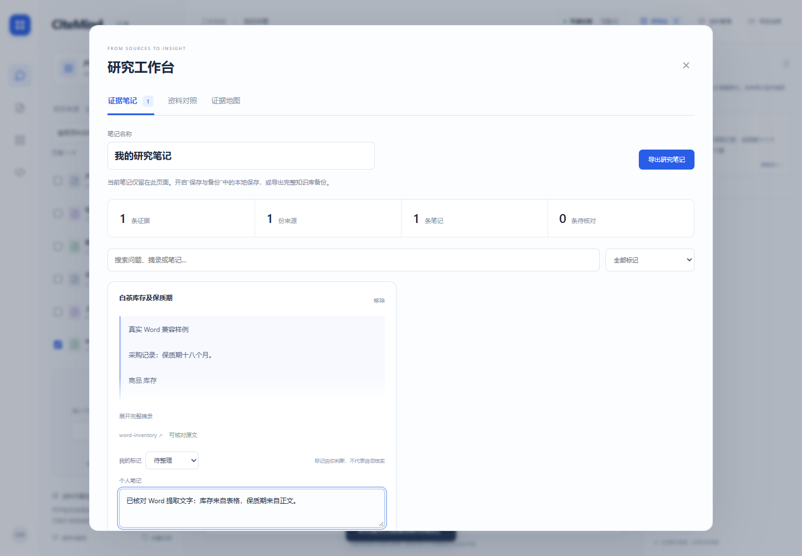
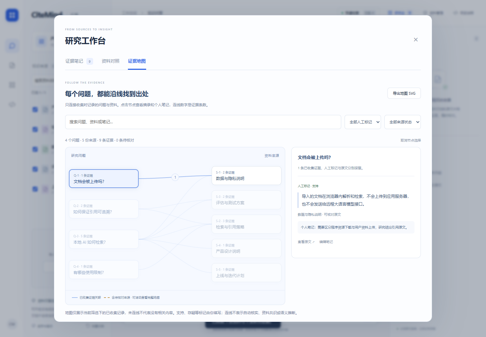
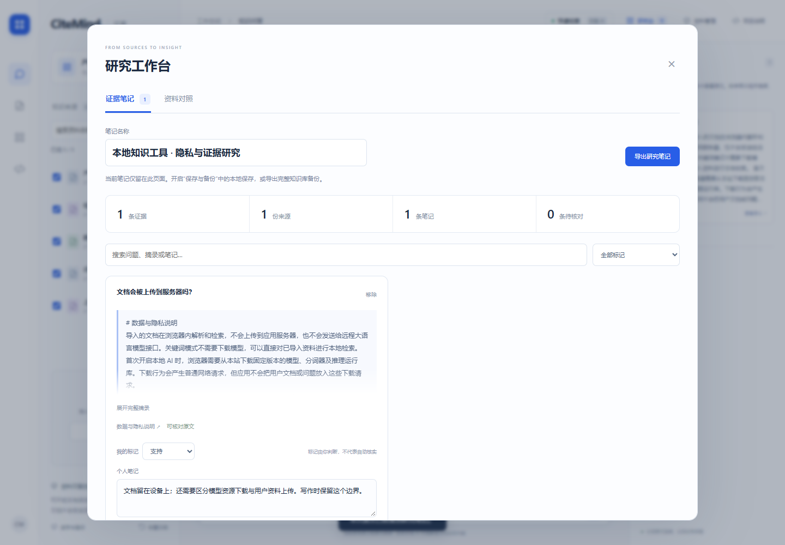

# CiteMind · 证据 v1.8.0

浏览器端 AI 研究工作台：选择资料、检索原文、收集证据、写笔记、对照多份资料，导出可核对的研究记录。

**在线体验：[打开 CiteMind](https://xf-png.github.io/citemind/)** · [源码仓库](https://github.com/xf-png/citemind) · [在线访问与验证说明](docs/在线访问说明.md)

直接打开链接即可使用示例知识库，无需安装软件或配置密钥。PDF、模型与 AI 运行组件随网站托管；资料解析和检索在你的浏览器中进行。v1.4 可主动准备完整离线包，断网后重新打开、导入 PDF、检索和整理证据。

## v1.8：准备离线包时，知道进度，也能取消

准备进度显示已校验的资源数量、大小和当前组件。下载较大的 AI 文件时，可以关闭设置窗口继续检索，也可以取消本次准备；取消更新会保留已就绪的旧版本、资料、笔记和未发送草稿。

[设计与取消验证](docs/离线准备与v1.8实现.md) · [准备中的界面](docs/screenshots/offline-preparation.png)

## v1.7：让研究成果独立阅读

在研究笔记中点击“生成研究报告”，预览并下载一个独立 HTML 文件：按问题整理摘录、人工标记、个人笔记与来源，可离线打开、查找和打印。

- 默认只导出已收集摘录和笔记，加入所引资料全文需要手动勾选；预览明确显示内容范围。
- 附上全文时，可以从证据跳到提取文字中的精确高亮。来源已移除或变动时保留警示，避免错误定位。
- 报告没有脚本、模型或外部资源依赖，手机也可阅读。知识库继续编辑与迁移仍使用 JSON 备份。

[查看示例报告](docs/examples/research-report.html) · [报告截图](docs/screenshots/research-report.png) · [Zotero 参考与验证记录](docs/研究报告与v1.7实现.md)

## v1.6：Word 也能成为可核对的证据

拖入 DOCX，在浏览器本地提取正文、表格及引用的脚注与尾注，直接接入检索、研究笔记、证据地图和备份。准备完整离线包后，断网重开也能导入 Word。

表格转为文字；引用高亮定位到提取文字，不推算 Word 页码。导入入口可展开查看范围说明，发现隐藏文字或嵌入内容时提示核对。损坏文件或同批其他文件读取失败时，原有资料保持完整。

[高星项目参考、实现和验证范围](docs/Word导入与v1.6实现.md)



## v1.5：让问题和出处连起来

在研究台打开“证据地图”：从问题走到资料，沿连线查看已收集摘录、人工标记和个人笔记，再回到精确原文位置。支持搜索、按人工标记和来源状态筛选、键盘选择，以及导出独立 SVG。



地图按实际收集记录连接，不推断语义关系或资料共识；失效来源保留警示。[设计与验证记录](docs/证据地图与v1.5实现.md) · [查看示例 SVG](docs/examples/evidence-map.svg)

v1.5.1 为程序模块和样式绑定版本及内容指纹，减少重复访问时旧缓存阻碍新功能的问题。[更新缓存修复与验证](docs/更新缓存与v1.5.1修复.md) · [公开网站的 29 条流程验证](docs/verification/release-v1.5.1-2026-11-06.json)

## v1.4：断网后，研究继续

- **一次准备，完整离线**：在“保存与备份”中下载约 53 MB 离线包，覆盖网页、PDF 组件及真实中文向量模型。默认不下载。
- **完整才算就绪**：当前版本 264 项资源逐项核对 SHA-256；下载失败不会覆盖原有可用版本。支持检查更新和修复不完整缓存。
- **保留当前工作**：新版等待本站旧页面关闭后启用，不强制刷新；更新时复用通过校验的旧模型文件。
- **分别管理程序与资料**：移除离线包不删除知识库和笔记。资料需另行开启本机保存，或导出完整 JSON 备份。

[离线使用、设计参考与验证范围](docs/离线使用与v1.4验证.md) · [离线包界面](docs/screenshots/offline-workspace.png)

## v1.3：从找到原文，到形成研究记录

- **限定范围**：搜索资料名称、逐份勾选，问答只检索选中的资料。
- **证据笔记**：一键收集引用，写个人批注并标记支持、存疑或背景。重复摘录按来源位置去重。
- **资料对照**：最多六个问题逐份检索，横向查看不同来源，保留需要进一步查证的空缺。
- **可靠保存**：笔记随资料一起保存和 JSON 备份，兼容旧备份；删除资料后仍保留笔记并显示来源警示。
- **带走成果**：导出附原文、页码和位置的研究笔记或资料对照 Markdown。
- **重复检索加速**：中文 BM25 倒排索引与有界缓存，保持原有评分及引用位置。合成语料实测与限制见[学习与实现记录](docs/高星项目学习与v1.3实现.md)。



[查看资料对照截图](docs/screenshots/source-comparison.png) · [高星项目学习与实现记录](docs/高星项目学习与v1.3实现.md)

## 已实现功能

- 导入 PDF、Word DOCX、TXT、Markdown，支持拖放文件或粘贴文字，内置 5 篇中文示例资料。
- PDF 提取文字后按页分块，引用定位到具体页码和原文位置，可切换文本页并核对高亮。支持文字层 PDF，不提供 OCR。
- 快速模式使用中文分词、汉字片段和英文技术词匹配；可选本地 AI 模式使用中文句向量召回，再对候选句进行语义重排，词语匹配作为补充依据。
- 返回相关原文、编号引用和实际检索耗时；资料不足时明确提示，支持导出带引用的 Markdown 问答。
- 可选择将知识库保存在当前浏览器的 IndexedDB，默认关闭；支持 JSON 知识库备份、合并或替换恢复。

本项目提供检索式问答和原文摘录，没有生成式大语言模型或远程推理接口。当前实现可用于生成式 RAG 的检索与证据层，尚未包含生成环节。检索分数用于排序，不是事实正确概率。

## 本地启动

需要 Python 3。完整解压源码包后，Windows 可双击 **启动应用.cmd**，脚本会启动本机静态服务并打开浏览器。关闭服务窗口即可停止。

也可在本 README 所在目录运行：

~~~sh
python tools/serve.py --no-browser
~~~

浏览器打开终端显示的地址，默认是 [http://127.0.0.1:4173](http://127.0.0.1:4173)；端口占用时脚本依次尝试 4174–4182。需要自动打开浏览器时去掉 --no-browser。

以下标准库命令也可使用：

~~~sh
python -m http.server --bind 127.0.0.1 4173 --directory dist
~~~

页面使用 ES Modules 和独立 Worker，请通过 HTTP 服务访问，不要直接双击 HTML。无需安装前端构建工具或配置 API Key。Python 只提供静态文件，不接收文档处理或模型推理请求。

快速检索不需要模型；首次导入 PDF 从本站加载 PDF.js，首次开启本地 AI 从本站下载约 47 MB 模型、分词器和运行组件。模型与运行库使用包含版本或修订号的路径，关闭 Hugging Face 远程回退，不需要访问 jsDelivr 或 Hugging Face。需要断网重开时，先在“保存与备份”准备完整离线包并确认“已就绪”。离线入口仍需使用相同浏览器及原网站地址；本机服务入口还需保持静态服务启动。

## 体验流程

1. 用示例资料提问：“这个知识库如何避免 AI 编造答案？”，点击引用核对原文。
2. 导入自己的文本、Word DOCX 或文字层 PDF，针对其中的事实提问，查看原文位置与 PDF 页码。
3. 在“保存与备份”中选择开启本机保存，刷新页面检查资料恢复。
4. 导出 JSON 备份，再尝试合并或替换恢复；问答记录另外导出为 Markdown。
5. 可选开启本地 AI，体验同义表达的检索，并检查资料之外的问题如何处理。
6. 可选准备完整离线包，确认就绪后断开网络、重新打开同一地址，继续检索或导入 PDF、Word。

## 资料范围与限制

| 项目 | 当前范围 |
| --- | --- |
| PDF | 单份不超过 10 MB、80 页、提取文字不超过 100,000 字符 |
| PDF 类型 | 可提取文字的 PDF；不支持 OCR、加密或受权限保护的文件 |
| PDF 阅读 | 展示提取文字和物理页码，不展示原 PDF 页面图像；复杂表格、分栏顺序需人工核对 |
| Word | 标准未加密 DOCX，单份不超过 10 MB、提取文字不超过 100,000 字符；不支持旧 DOC、宏文档、模板或 ZIP64 |
| Word 阅读 | 正文、表格、引用的脚注与尾注转为文字；不保留版式、图片、页眉页脚或物理页码，复杂内容需核对 |
| 文本导入 | TXT / Markdown 使用 UTF-8；单文件不超过 1 MB，单篇不超过 100,000 字符 |
| 知识库 | 最多 20 篇，原文合计不超过 250,000 字符 |
| JSON 备份 | 不超过 6 MB，恢复时校验格式、字段和页码，再重建索引 |

PDF 页码必须完整连续，从 1 开始，保留空白页元数据。分块不跨页，页文字和引用位置使用原文的 JavaScript UTF-16 索引，避免清理文字时移动引用。

## 保存与隐私

本机保存默认关闭，未开启时文档和问答只存在于当前页面，刷新恢复示例资料。开启后，当前知识库文字、PDF 分页信息和研究笔记写入 IndexedDB；下次在同一浏览器、同一站点地址访问时恢复。聊天记录和模型向量不会随知识库保存。关闭本机保存会移除浏览器中的资料副本。

JSON 备份包含文档标识、标题、文字、PDF 页码及位置和研究笔记，不包含原始 PDF / Word 文件、聊天记录或模型向量。Word 以提取文字保存，兼容已有备份格式。备份是含资料原文的普通 JSON，应自行妥善保管。Markdown 导出用于保存问答和引用，不能替代知识库备份。

文件解析、文档检索和模型计算在浏览器中进行，不把资料或问题发送到应用服务器、模型托管服务或远程大语言模型。首次加载会向本站请求 PDF 组件、模型和运行资源，网站托管商仍可收到常规网络请求。浏览器可能缓存模型文件；清除站点数据、换浏览器、换地址或换设备，可能需要恢复备份或重新下载模型。

完整离线包使用独立的 Cache Storage，只缓存固定清单内的程序文件，不缓存用户导入的文件、问题或笔记。离线包与 IndexedDB 资料保存是两个独立选择；浏览器可能因空间不足回收缓存，重要资料请保留导出备份。

## 技术结构

~~~text
dist/
  index.html / styles.css  页面与响应式样式
  app.js                  导入、引用、页码界面、保存及导出交互
  engine.js               分块、检索、句级重排和引用位置
  model.js                本地嵌入模型与独立 Worker
  pdf.js                  PDF.js 文字提取与页码元数据
  docx.js / docx-zip.js    有界 ZIP 读取与 Word 纯文本提取
  storage.js              IndexedDB 保存、JSON 校验及备份恢复
  research.js / research-ui.js  证据笔记、资料对照和 Markdown 导出
  evidence-map.js / evidence-map-ui.js  收集记录的来源地图与 SVG 导出
  research-report.js / research-report-ui.js  独立 HTML 研究报告与隔离预览
  offline.js / sw.js       主动准备、完整性校验和版本隔离的离线包
  vendor/                 随站点托管的 PDF.js、Transformers.js 与 WASM
  models/                 固定修订的中文 BGE q8 模型与分词器
  *-assets.json           第三方资源来源、字节数与 SHA-256 清单
tests/
  engine.test.mjs         检索、PDF 引用和语义重排检查
  storage.test.mjs        备份格式、资料范围和保存状态检查
  research.test.mjs       范围隔离、来源状态、备份合并与研究导出
  browser/               桌面与移动布局的完整用户流程
tools/serve.py            Python 标准库本地静态服务
tools/verify-assets.mjs   检查全部第三方资源完整性，可验证公开 URL
tools/build-offline.mjs   根据 dist 生成离线资源清单与 Service Worker
启动应用.cmd             Windows 启动入口
~~~

文档按句段边界分为最多 420 字符的块，相邻块保留 64 字符重叠；PDF 分页边界优先。快速检索参考 BM25，以词频、稀有度、块长度和标题匹配排序，再用全库词频加权选择摘录句。

本地 AI 使用 Transformers.js 3.8.1、ONNX Runtime / WASM 与 Xenova/bge-small-zh-v1.5。q8 模型权重约 24 MB，另需分词器和 WASM；模型使用 CLS 池化，输出 512 维归一化向量。独立 Worker 承担加载和推理，支持小批量排队、下载进度、取消、超时和重试。

语义链路先召回相关块，再嵌入候选原句，结合余弦相似度和次要的词语匹配进行重排。块向量和句向量在内存中缓存。引用保留文档 ID、分块 ID、原句位置和可选的 PDF 页码；用户内容用文本节点显示，不作为 HTML 执行。

主要接口为 prepareDocuments、retrieve、configureEmbedder 与 answerQuestion。PDF 输入包含 type: 'pdf' 和 pages: [{pageNumber, text, start, end}]；结果中的来源包含 excerpt、start、end 和可选的 pageNumber。

参考：[Transformers.js 文档](https://huggingface.co/docs/transformers.js/v3.8.1/index)、[BGE 模型](https://huggingface.co/Xenova/bge-small-zh-v1.5)、[PDF.js API](https://mozilla.github.io/pdf.js/api/draft/module-pdfjsLib.html)。

## 验证

引擎、存储、研究数据、Word 压缩读取与发布构建共 48 项功能检查；浏览器共 68 条用例，67 条执行、1 条跳过（真实 AI 推理仅在桌面执行一次）。移动布局使用桌面 Chrome 的 390px 视口，不等于手机真机验证。

```sh
npm ci
npm test
# 首次在 Linux / CI 安装 Chromium；Windows 默认使用已安装的 Chrome
npx playwright install chromium
npm run test:browser
npm run verify:assets
npm run verify:offline
# 可选：合成语料上的重复检索对比，需要完整 Git 历史
npm run benchmark
```

研究功能、来源失效处理、备份兼容和性能测量范围见[本轮实现与验证](docs/高星项目学习与v1.3实现.md)。

离线检查覆盖断网刷新后的资料和笔记保存、真实 BGE / ONNX 推理、真实两页 PDF 导入和页码引用、损坏下载拒绝、缓存修复、移除时保留资料及其他应用缓存，以及升级复用模型和等待旧页面关闭。详见[v1.4 验证记录](docs/离线使用与v1.4验证.md)。修改 `dist/` 或离线脚本模板后，运行 `npm run build:offline` 并提交生成的 `dist/sw.js`；CI 会拒绝过期清单。

地图另检查了同名资料隔离、筛选与失效来源、100 条记录布局、SVG 转义，及桌面 / 移动布局的 10 条操作流程；包括删除前序记录后选择仍指向同一问题和资料。v1.4 已在线通过 16 条研究流程及断网重开、实际模型加载和两页 PDF 引用的 3 条完整流程。


需要 Node.js，在项目目录运行：

~~~sh
node tests/engine.test.mjs
node tests/storage.test.mjs
~~~

两组脚本共 24 项功能检查：引擎 16 项、存储 8 项，覆盖输入依赖、引用可追溯、PDF 页码与原文位置、无关资料、句级语义重排、缓存、错误嵌入、备份白名单及保存状态。注入向量测试用于验证算法行为，不能代替真实模型效果评估。

v1.1 曾验证过真实模型与 PDF 链路；v1.2 将固定资源改为本站托管。v1.4 重新在浏览器中运行完整模型推理和实际 PDF 解析：准备离线包后关闭网络，再次加载模型，隐私问题返回对应原句；两页 PDF 的引用定位到第二页。这里没有用假嵌入或替换模型响应，不据此承诺所有设备的速度或兼容性。

还验证了连续修改的保存顺序：前一份资料提交完成、后一份仍等待时保持“正在保存”，最新资料真正写入后才显示完成，刷新可恢复最新状态。

当前没有人工标注集上的准确率、Recall@K、MRR、真实用户量或业务收益数据。

## 部署与后续方向

部署包必须包含完整 dist/，包括 vendor/、models/ 和资源清单，不能只上传顶层九个页面文件。托管服务应支持 HTTPS、同源 ES Modules、Worker 和 application/wasm。发布后需从实际用户网络验证访问，再把有效地址写入简历；已有部署记录不代表地址可用。

后续可增加扫描件 OCR、增量索引及规模更大的人工标注检索评估。若加入生成式回答，需要另行实现远程发送告知、服务端密钥保护和引用校验。

## 第三方资源与发布校验

资源固定于 Transformers.js 3.8.1、PDF.js 6.4.299 和 BGE 修订 75c43b069aac4d136ba6bc1122f995fedcfd2781。上游许可随资源保留；参见 dist/THIRD_PARTY_NOTICES.md。GitHub Actions 会先执行全部功能检查、桌面与移动布局浏览器流程及资源清单 SHA-256 校验，再发布完整 dist。

~~~sh
node tools/verify-assets.mjs
node tools/verify-assets.mjs https://xf-png.github.io/citemind/
~~~
