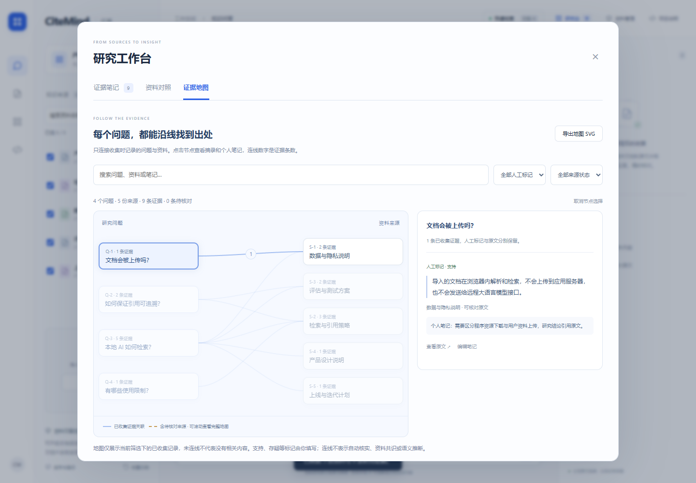

# 从研究问题，沿线找到出处

2026-11-05，CiteMind v1.5。证据地图基于已有的研究笔记生成：左侧是收集时记录的问题，右侧是对应资料，连线聚合两者之间的证据记录。

## 学习对象

阅读 [Cytoscape.js](https://github.com/cytoscape/cytoscape.js)（本次 GitHub API 返回 11,267 stars，星数会变化）的官方 [Elements JSON](https://js.cytoscape.org/#notation/elements-json) 与布局说明：用明确节点标识和连接记录表达关系，将图的数据、布局和显示分开处理。

CiteMind 独立编写了面向最多 100 条证据的二部图，不引入 Cytoscape.js 运行库或外部图服务。原生 SVG 绘线，HTML 按钮承载节点和键盘交互。没有复制上游代码，也没有新增运行时依赖。

## 如何使用

1. 在问答结果或资料对照中收集需要的原文，进入研究台的“证据地图”。
2. 点击问题，查看此问题下来自不同资料的摘录；点击资料，查看从该资料收集的记录。
3. 查看人工标记、个人笔记和来源状态。通过“查看原文”回到精确位置；PDF 保留物理页码。
4. 用搜索、人工标记及来源状态筛选缩小范围。“编辑笔记”回到对应卡片并聚焦输入框。
5. 导出当前筛选下的 SVG 地图。可独立打开或放入文档，完整恢复仍使用知识库 JSON 备份。

移动布局可左右滑动看另一侧节点，上下滚动查看较大的地图。节点可使用 Tab / Enter 选择；三个研究页签支持方向键、Home 和 End。

## 数据含义与边界

- 连线只来自已经收集的记录；没有收集的文档或问题不自动加入。没有连线不代表资料中没有相关内容。
- 同一问题仅合并前后空白与重复空白，不使用模型推断同义关系。没有记录问题的摘录归入“未记录具体问题”。
- 同名资料按文档 ID 区分。一个问题与同一来源的多条记录聚合为一条连线；数字是记录数量，不是相关度、正确率或可信度。
- 点击节点后显示对应连线条数，其他关系变淡。未选中时不在所有交叉线上叠数字，减少遮挡。SVG 快照保留节点条数及连线悬停说明。
- 已移除或内容、页码变动的来源保留摘录和笔记，使用警示颜色及虚线，不允许跳往错误原文。
- 选择按实际问题内容和文档 ID 保留，删除前面的卡片、节点重新编号后不会误选其他记录。
- 图表直接从现有研究数据生成，不增加另一份持久化状态或上传行为。离线包已包含新增模块，完整包仍约 53 MB，共 260 项资源。
- SVG 是当前筛选的概览快照，包含笔记名称、问题及资料标题，不包含资料全文、摘录正文或个人批注。长标题在图中缩短，完整标题放在 SVG 文本提示中；无脚本、远程资源或可执行链接。

程序只核对摘录与当前原文的对应位置，不核查事实真假。支持、存疑与背景是用户标记；地图不自动判断资料间的共识、矛盾或因果。

## 本轮验证

新增 4 项数据检查：记录与连线对应、同名资料隔离及筛选稳定；缺失、变更和错误 PDF 页码；SVG 安全转义及筛选范围；100 条记录布局的边界、非重叠与确定性。

浏览器新增 5 条流程，各在桌面和 390px 移动视口执行，共 10 条：

- 点击问题和来源显示正确记录，筛选后导出的 SVG 只包含对应范围，并能作为 XML 正常解析。
- 键盘切换页签、选择节点、跳回编辑，并在地图中看到新笔记。
- 失效来源保留批注，禁止错误跳转。
- 含 HTML 的标题保持文字显示；PDF 记录跳至第二页并高亮实际摘录。
- 删除前序卡片引起重新编号后，选择仍指向相同的问题和来源。

加上已有检查，目前共 38 项功能检查和 42 条浏览器用例，其中真实模型推理仅桌面执行，合计 41 通过、1 跳过。真实手机、Safari 与大规模图形性能未验证。

[示例 SVG](examples/evidence-map.svg) 使用项目自带五篇示例资料，收集九条记录，人工标记和笔记用于展示操作，不是独立检索评估或真实用户研究成果。
